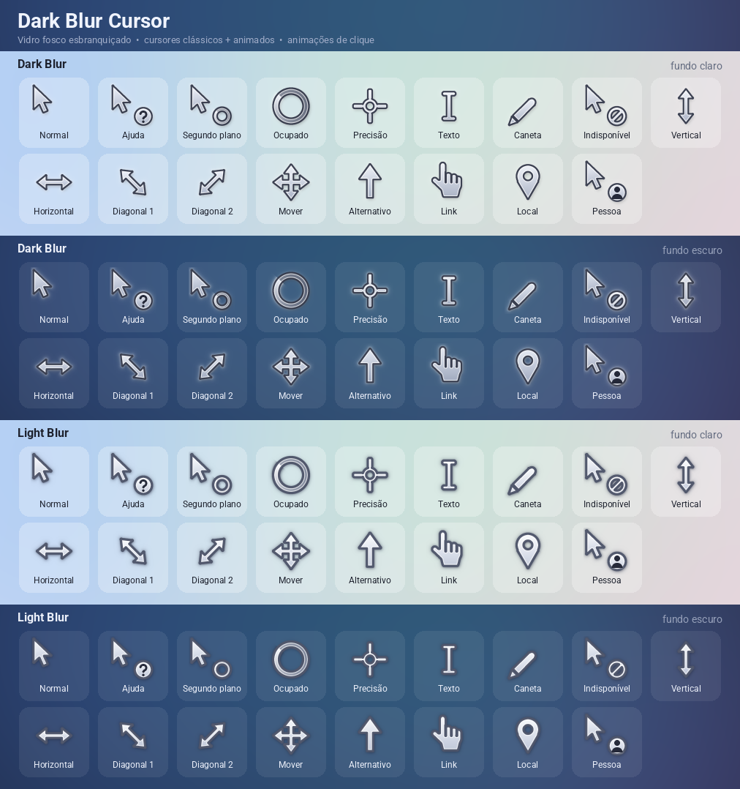
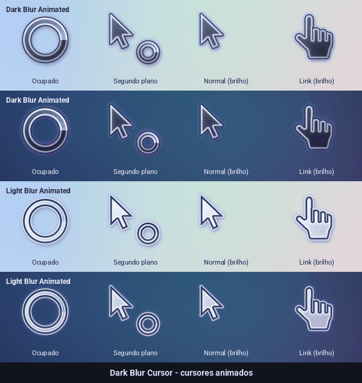
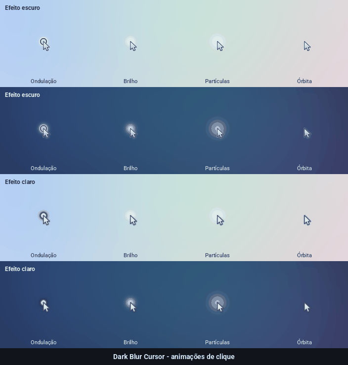

<p align="center">
  
</p>

<p align="center">
  
  &nbsp;
  
</p>

# Dark Blur Cursor

Pacote de cursores para Windows em estilo **vidro fosco esbranquiçado**, 100 % monocromático (sem cores), em dois temas:

- **Dark Blur** — corpo branco-fosco, brilho branco suave ao redor e contorno fino mais escuro para dar definição (ideal para fundos escuros).
- **Light Blur** — também branco-fosco, mas com contorno cinza mais forte e sombra cinza suave para ler bem em fundos claros.

Esquema clássico (estático) e **esquema animado em que todos os cursores são `.ani`**: um brilho branco varre cada cursor e o brilho ao redor
pulsa (loop de 1,6 s, 24 quadros); Ocupado/Segundo plano têm um anel girando de alto contraste.
Também há **animações de clique** em AutoHotkey v2 (brancas/cinza, grandes), com tema claro/escuro.

## Conteúdo

| Pasta | O que tem |
| --- | --- |
| `dark/cursor-classic/` | esquema **Dark Blur**: 17 cursores `.cur` + 10 extras (Windhawk) + `install.inf` |
| `dark/cursor-animated/` | esquema **Dark Blur Animated**: todos os cursores em `.ani` (brilho branco varrendo + pulso do brilho; anel girando em Ocupado/Segundo plano) + `install.inf` |
| `light/cursor-classic/` | esquema **Light Blur** |
| `light/cursor-animated/` | esquema **Light Blur Animated** |
| `click-animations/` | `click-animations.ahk` + efeitos pré-renderizados `ripple`, `glow`, `particle`, `orbit` em `-dark.bgra` e `-light.bgra` |
| `preview/` | prévias em PNG/GIF |
| `tools/` | scripts Python que geram tudo |

Cursores do esquema: Normal, Ajuda, Segundo plano, Ocupado, Precisão, Texto, Caneta, Indisponível,
Redimensionar vertical / horizontal / diagonal 1 / diagonal 2, Mover, Alternativo, Link, Local e Pessoa.
Extras: `alias`, `copy`, `cell`, `col-resize`, `row-resize`, `zoom-in`, `zoom-out`, `grab`, `grabbing`, `vertical-text`.

**Tamanhos:** base de 32×32 px (100 % de escala) com as proporções dos cursores padrão do Windows
(a seta mede ~13×19 px e a mão ~21×25 px, já com o contorno). 48 e 64 px são as variantes padrão para
125–200 % de DPI; 96 e 128 px são o mesmo desenho ampliado (cursor grande). Os `.ani` têm 32, 48 e 64 px.
Os pontos ativos (*hotspots*) são os mesmos nos dois temas.

## Como instalar o esquema de cursores

1. Baixe o release (ou clone o repositório) e extraia em uma pasta **permanente**.
2. Abra a pasta do tema e do tipo que quer, por exemplo `dark/cursor-classic` ou `light/cursor-animated`.
3. Clique com o botão direito em **`install.inf`** > **Instalar** (confirme o pedido de administrador).
   Os arquivos vão para `C:\Windows\Cursors\<nome do esquema>` e o esquema é registrado.
4. Abra **Configurações > Bluetooth e dispositivos > Mouse > Configurações adicionais do mouse** (ou `Win + R` > `main.cpl`),
   aba **Ponteiros**, escolha o esquema (**Dark Blur**, **Dark Blur Animated**, **Light Blur** ou **Light Blur Animated**) e clique em **Aplicar**.
5. Dica: desmarque **Habilitar sombra do ponteiro** — os cursores já têm sombra própria.
6. Para aumentar o cursor: **Configurações > Acessibilidade > Ponteiro do mouse e toque**.

Os quatro esquemas podem ficar instalados ao mesmo tempo (cada um em sua pasta).

### Desinstalar

Escolha outro esquema na aba **Ponteiros**, selecione o esquema e clique em **Excluir**. Depois apague
`C:\Windows\Cursors\<nome do esquema>`.

## Cursores extras com o Windhawk (Cursor Override)

O esquema do Windows não tem espaço para copiar, atalho, zoom, mão aberta/fechada, célula etc.

1. Mantenha o pacote em uma pasta permanente (ex.: `C:\Users\SeuNome\Cursors\Dark Blur Cursor`).
2. Instale o [Windhawk](https://windhawk.net/) e, nele, o mod [Cursor Override](https://windhawk.net/mods/cursor-override).
3. Na aba **Settings** do mod, informe o **caminho completo** de cada arquivo, por exemplo
   `C:\Users\SeuNome\Cursors\Dark Blur Cursor\dark\cursor-classic\copy.cur`.
4. Salve as configurações.

## Animações de clique (AutoHotkey v2)

Cada clique esquerdo toca um efeito monocromático (branco/cinza) na posição do ponteiro, independente do esquema de cursores e do Windhawk.

1. Instale o [AutoHotkey v2](https://www.autohotkey.com/).
2. Mantenha na mesma pasta: `click-animations.ahk`, os oito arquivos `*.bgra` e `dark-blur.ico`.
3. Dê duplo clique em `click-animations.ahk`. Um ícone aparece na bandeja do sistema.
4. Botão direito no ícone da bandeja:
   - **Animações de clique ativadas** — liga/desliga;
   - efeito: **Ondulação**, **Brilho**, **Partículas** ou **Órbita**;
   - tema do efeito: **automático (segue o tema de apps do Windows)**, **escuro** ou **claro**;
   - **Iniciar com o Windows** — cria/remove o atalho na pasta de inicialização;
   - **Sair**.
5. Atalhos: `Ctrl + Alt + F9` liga/desliga, `Ctrl + Alt + F10` próximo efeito, `Ctrl + Alt + F11` próximo tema.

As escolhas ficam em `settings.ini`, na mesma pasta do script.

**Iniciar automaticamente:** use **Iniciar com o Windows** no menu da bandeja, ou `Win + R` > `shell:startup`
e coloque ali um atalho para `click-animations.ahk`. Se mover a pasta depois, desmarque e marque a opção de novo.

**Formato dos efeitos (`.bgra`):** 40 frames de 160×160 px, 32 bits, de cima para baixo, bytes B, G, R, A com alfa
**pré-multiplicado** (4.096.000 bytes por arquivo), desenhados via `UpdateLayeredWindow` em uma janela que ignora cliques.
Teste de carregamento sem abrir a sobreposição: `AutoHotkey64.exe click-animations.ahk --check`.

## Recriar / personalizar

```bash
pip install -r tools/requirements.txt
python tools/build_cursors.py   # dark/ e light/  (.cur, .ani, install.inf)
python tools/build_click.py     # click-animations/*.bgra
python tools/build_preview.py   # preview/
python tools/verify.py          # confere .cur/.ani, hotspots, .inf e .bgra
python tools/make_release.py    # zips por tema + zip completo em dist/
```

Desenhos em `tools/designs.py` (grade 32×32); visual (contorno, brilho e temas) em `tools/cursorlib.py` (`THEMES`).

## Observações

- Hotspots: ponta da seta, ponta do indicador (Link), ponta da caneta, ponta do pin (Local) e centro nos demais.
- O esquema clássico usa `.cur` estáticos também para *Segundo plano* e *Ocupado*; para o anel girando use o esquema animado.
- Se um cursor animado aparecer embaçado em algum ajuste de DPI (os `.ani` não têm 96/128 px), use o esquema clássico.

## English (short)

**Dark Blur Cursor** is a monochrome Windows cursor theme with a whitish frosted body, thin darker edge and soft glow: a dark-background
variant (white glow) and a light-background variant (stronger gray edge and shadow), each with a classic (static) and an animated scheme (every cursor is an `.ani` with a
sweeping white shimmer and pulsing glow), plus AutoHotkey v2 click animations (ripple, glow, particles, orbit) with a dark/light/auto theme.

- **Install a scheme:** extract the release, open e.g. `dark/cursor-classic`, right-click `install.inf` > *Install*, then pick
  *Dark Blur* / *Dark Blur Animated* / *Light Blur* / *Light Blur Animated* in *Mouse > Pointers*.
- **Extra cursors** (copy, alias, zoom, grab...): use the [Windhawk](https://windhawk.net/) *Cursor Override* mod and point
  each entry at the full path of the `.cur` file.
- **Click animations:** install [AutoHotkey v2](https://www.autohotkey.com/), keep `click-animations.ahk` with the `*.bgra`
  files, double-click the script, and use the tray menu (toggle, effect, theme, start with Windows, exit).
- **Sizes:** 32 px base with stock Windows proportions; 48/64 for higher DPI; 96/128 are scaled versions.
- **Rebuild:** `pip install -r tools/requirements.txt`, then run the scripts in `tools/` (see above).

## Licença / License

MIT — veja [`LICENSE`](LICENSE).
